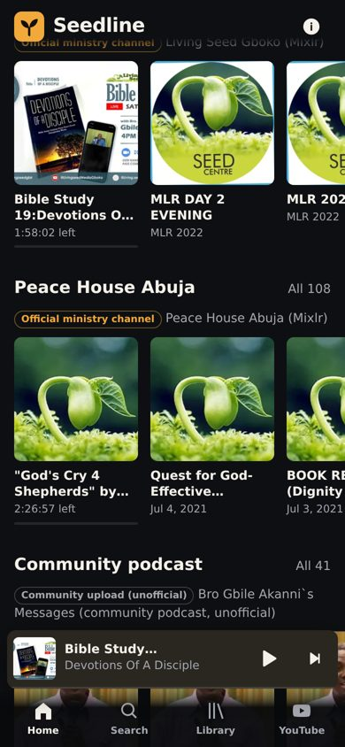
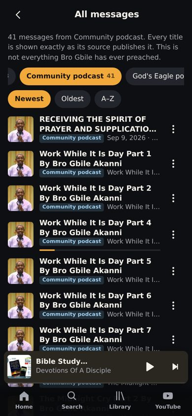

# Seedline

**An unofficial listening app for messages of Bro Gbile Akanni.**

> Unofficial listening app. Audio streams straight from each original public source (Mixlr channels, podcast hosts, SermonIndex); nothing is copied or re-hosted. All rights belong to their owners.
> Seedline is **not** made by, run by or affiliated with Living Seed.

Seedline is a small, Spotify‑style web app you can install on your phone (it's a PWA). It plays messages straight from their **original public hosts**, the way a podcast app does. It does **not** download, copy, convert or re‑host any audio, and it never rips YouTube. Every message links back to its original page.

Live app: https://fikayomi2009.github.io/Seedline/

<p>   </p>

## What's in the library

**422 playable entries** at the last build (427 source entries; 5 duplicates folded together). 71 of them are Mixlr recordings that only carry Mixlr's automatic name (e.g. "Peace House Abuja on Mixlr"); the app says so. This is **not** a complete collection of Bro Gbile Akanni's teaching.

| Source | Type | Label | Entries |
|---|---|---|---|
| Living Seed Gboko – `living-seed-gboko.mixlr.com` | Mixlr (live) | Official ministry channel | 87 |
| Peace House Abuja – `peacehouseabuja.mixlr.com` | Mixlr (live) | Official ministry channel | 108 |
| "Bro Gbile Akanni`s Messages" (Temiloluwa Olanrewaju) | Podcast RSS | Community, unofficial | 41 |
| God's Eagle Ministries podcast (Ambassador Monday O. Ogbe) – only episodes whose title credits Bro Gbile | Podcast RSS | Community, unofficial | 21 (2 are copies of others) |
| Maranatha Teaching Podcast – only episodes titled "Bro Gbile Akanni" | Podcast RSS | Community, unofficial | 10 |
| Christian Mirror Podcast – 1 episode | Podcast RSS | Community, unofficial | 1 |
| Kingdom Grace Media podcast – 1 episode | Podcast RSS | Community, unofficial | 1 |
| SermonIndex speaker page (`sermonindex.net/speakers/gbile-akanni/`) | Sermon archive | Third-party archive | 158 (3 are copies of podcast episodes) |

- **Titles are exact.** Each title is shown as its source publishes it (checked by `tests/verify-sources.mjs`).
- **Speaker** is named only when the title (or, for SermonIndex, the speaker page) says so: "Bro Gbile Akanni", "Sade Akanni (named in title)", or "Living Seed / Peace House (speaker not stated)".
- **Duplicates**: when the same recording is on several sources, it is listed once and the other copies are kept as backups (official first). Matching is deliberately strict — same title after removing speaker credits **and** length within 90 s / 3 % — so a few duplicates may still appear twice, but different preachings that share a title are never merged.
- **Mixlr** links expire after ~7 days, so they are never stored; the app reads both Mixlr channels live every time it opens (so new recordings appear automatically) and fetches a fresh link when you press play.
- **Podcast / SermonIndex** entries store the publisher's own audio URL (podcast enclosure / SermonIndex file server).
- SermonIndex shows the same placeholder upload date on every message, so Seedline shows **no date** for those.
- **YouTube**: 312 Saturday Bible Study videos with an "Open on YouTube" button. When an audio entry is clearly the same message, the video shows **Listen in app** and the audio shows **Also on YouTube**. Matching is conservative (most YouTube titles are just "Bible Study With Brother Gbile Akanni"), so at the last build only **1** match was made.

### Series and topics
- Series are only taken from clear title patterns: "Bible Study NN: *Series* – *Title*" → *Series*; "MLR/SAYCO/CLR 20xx" → that event; "UK Solemn Assembly"; and "*Name* Part N" when at least two parts share the name.
- Topics (Discipleship, Prayer, Holiness, Revival, Faith, Christian Living) are **auto‑tagged** only when the title contains a clear keyword (rules are in `js/logic.js`, `CATEGORY_RULES`). Everything else is "Uncategorised". A title can have more than one topic.
- Counts at the last build: Discipleship 18 · Prayer 19 · Holiness 8 · Revival 3 · Faith 9 · Christian Living 46 · Uncategorised 325.

## Features

- **Player**: one audio element, continuous queue, auto‑play next, play/pause, previous/next, shuffle, repeat (off / all / one), seek bar, ±15/30 s skip, volume.
- **Queue**: see what's next, move up/down, remove, clear, "Play next", "Add to queue".
- **Lock‑screen controls** (Media Session API): title, artwork, play/pause, previous/next, seek.
- **Home**: Continue listening, New on Mixlr, Series, Browse by topic, Latest uploads, and a section per source.
- **Source filter**: chips on Search and All messages; source badges on every row; Library → Browse by source.
- **Backup sources**: if a message fails to play, the player says so plainly and offers "Try *other source*" when another copy exists.
- **Search**: instant, by title, topic, series, year or keyword (also searches the YouTube list).
- **Library**: Favourites and your own playlists (create, rename, reorder, remove, delete, play all / shuffle).
- **Remembers on this device**: playlists, favourites, queue, where you stopped in each message (saved every ~5 s, on pause and when you leave), volume, shuffle/repeat, which recordings you've already seen.
- **Check for new messages**: compares the live Mixlr list with what you saw last time and shows a "New" badge.
- **Expired links handled**: Mixlr's audio links expire after about 7 days, so Seedline never stores them. It fetches fresh links when it opens, and if a link fails it fetches a new one and continues from the same spot.
- **Installable** (manifest + service worker). The service worker caches only the app itself — **never audio**.
- **Optional admin dashboard** (needs Supabase, see SETUP.md): edit/categorise/hide messages for everyone, add messages with a direct audio link (labelled "requires permission from the owner"), manage featured playlists. Until it's configured, the Admin page says "Not configured yet — see SETUP.md" and nothing pretends to work.

## Honest limitations

- **Background play**: in Chrome on Android (or the installed app), audio keeps playing with the screen locked and moves to the next message by itself. **On iPhone/iPad, Safari may pause between messages** when the screen is locked.
- Background/lock‑screen playback could **not** be tested automatically (it needs a real phone). It was built using the standard Media Session API.
- Needs internet to play (audio streams from the original hosts). Offline, you can open the app and browse the saved list, but not listen.
- If Mixlr is down, Mixlr messages can't play but podcast and SermonIndex messages still do.
- If a source changes or removes its API, feed or a recording, Seedline can't play it. The catalogue builder keeps the last known entries of a source it can't reach and reports it.
- Community podcasts and SermonIndex are third-party uploads. Seedline labels them as such; it can't vouch for their completeness or audio quality.
- Your playlists and progress live in this browser only. Clearing site data or switching phones loses them.
- Topic tags are keyword‑based and can be wrong; they never change titles.
- The admin features were written against Supabase but **have not been tested with a real Supabase project**.

## How it's built

Plain HTML, CSS and JavaScript modules — no build step — so GitHub Pages can serve it directly.

```
index.html            app shell
styles.css            styles (dark theme, mobile-first)
config.js             Supabase URL + anon key (empty by default)
manifest.webmanifest  install info
sw.js                 service worker (app shell only, never audio)
catalog.json          every source's messages (real titles; static audio URLs for podcasts/SermonIndex, none for Mixlr)
youtube.json          the 312 YouTube entries (real titles, plus listenId for matched audio)
js/app.js             screens, navigation, mini/full player UI
js/player.js          audio, queue, Media Session, saving progress
js/data.js            loads catalog + live Mixlr API (both channels), "new" detection, link refresh
js/logic.js           pure logic (sources, series, topics, dedupe, YouTube matching, search, queue helpers)
js/store.js           on-device storage
js/admin.js, supa.js  optional admin dashboard (Supabase)
supabase/schema.sql   database tables and security rules for the admin backend
tools/build-catalog.mjs  rebuilds catalog.json from all sources (see SETUP.md)
tests/                unit tests and browser tests
```

## Tests

- `node tests/unit.test.mjs` — logic tests (18 pass), incl. dedupe rules, speaker attribution, mixed-feed filtering, conservative YouTube matching, multi-channel merge.
- `node tests/verify-sources.mjs` — checks every catalogue title against the live sources and that every static audio URL answers with audio (all passed at the last build).
- `node tests/e2e.test.mjs` — real headless Chromium (needs `npm i -D playwright` and a Chromium). Results of the last run are in `tests/e2e-results.json` (26/26 passed): library load from both Mixlr channels, search, play, seek, next/prev, auto‑advance, repeat‑one, shuffle, queue, playlists, favourites, progress after reload, expired‑link refresh, "new" detection, admin "not configured", YouTube links, service worker, Mixlr‑down behaviour, **one message from every source plays**, dedupe, failing‑URL → "Try other source", source filter chips, auto‑advance across sources, YouTube "Listen in app".
