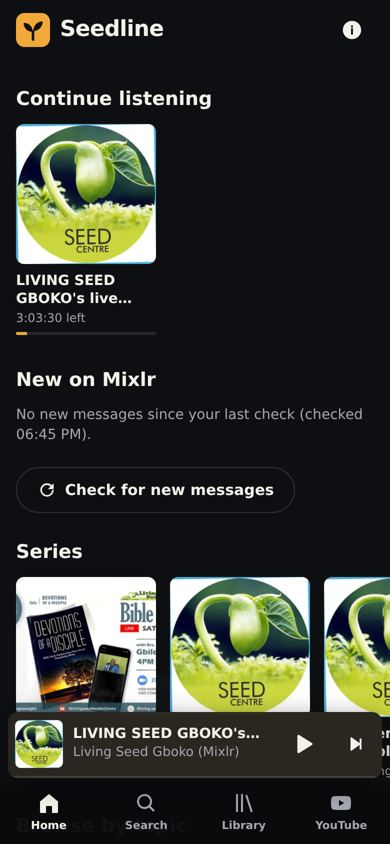
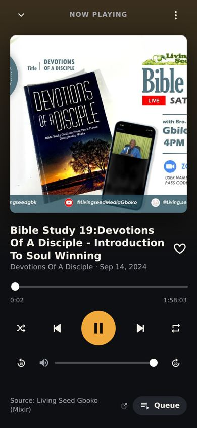

# Seedline

**An unofficial listening app for messages of Bro Gbile Akanni.**

> Unofficial listening app. Audio streams from Living Seed Gboko's public Mixlr channel; all rights belong to their owners.
> Seedline is **not** made by, run by or affiliated with Living Seed.

Seedline is a small, Spotify‑style web app you can install on your phone (it's a PWA). It plays recordings straight from the **public Mixlr channel of Living Seed Gboko** (`living-seed-gboko.mixlr.com`). It does **not** download, copy, convert or re‑host any audio. Every message links back to its original Mixlr page.

Live app (after GitHub Pages is switched on, see [SETUP.md](SETUP.md)): https://fikayomi2009.github.io/Seedline/

<p> </p>

## What's in the library

- **87 recordings** from the Mixlr channel at the time of building (the channel lists 95; 8 are skipped because they are 0–36 second blank/test clips). Titles are shown **exactly** as Mixlr has them. 17 of them only have Mixlr's automatic name (e.g. "LIVING SEED GBOKO on Mixlr"), and the app says so.
- The app also reads the **live** Mixlr list every time it opens, so new recordings appear automatically.
- **312 Saturday Bible Study videos on YouTube**, listed with their real titles and an "Open on YouTube" button. They are **not** played inside Seedline, because YouTube's rules don't allow other apps to play its videos in the background with the screen off.
- This is **not** a complete collection of Bro Gbile Akanni's teaching. It is only what that one Mixlr channel (plus the YouTube list) contains.

### Series and topics
- Series are only taken from clear title patterns: "Bible Study NN: *Series* – *Title*" → *Series*; titles starting "MLR" → "MLR 2022"; "UK Solemn Assembly" → "UK Solemn Assembly 2020".
- Topics (Discipleship, Prayer, Holiness, Revival, Faith, Christian Living) are **auto‑tagged** only when the title contains a clear keyword (rules are in `js/logic.js`, `CATEGORY_RULES`). Everything else is "Uncategorised". A title can have more than one topic.
- Counts at build time: Discipleship 8 · Prayer 2 · Holiness 4 · Revival 1 · Faith 1 · Christian Living 15 · Uncategorised 60 (27 recordings have at least one topic).

## Features

- **Player**: one audio element, continuous queue, auto‑play next, play/pause, previous/next, shuffle, repeat (off / all / one), seek bar, ±15/30 s skip, volume.
- **Queue**: see what's next, move up/down, remove, clear, "Play next", "Add to queue".
- **Lock‑screen controls** (Media Session API): title, artwork, play/pause, previous/next, seek.
- **Home**: Continue listening, New on Mixlr, Series, Browse by topic, Latest uploads.
- **Search**: instant, by title, topic, series, year or keyword (also searches the YouTube list).
- **Library**: Favourites and your own playlists (create, rename, reorder, remove, delete, play all / shuffle).
- **Remembers on this device**: playlists, favourites, queue, where you stopped in each message (saved every ~5 s, on pause and when you leave), volume, shuffle/repeat, which recordings you've already seen.
- **Check for new messages**: compares the live Mixlr list with what you saw last time and shows a "New" badge.
- **Expired links handled**: Mixlr's audio links expire after about 7 days, so Seedline never stores them. It fetches fresh links when it opens, and if a link fails it fetches a new one and continues from the same spot.
- **Installable** (manifest + service worker). The service worker caches only the app itself — **never audio**.
- **Optional admin dashboard** (needs Supabase, see SETUP.md): edit/categorise/hide messages for everyone, add messages with a direct audio link (labelled "requires permission from the owner"), manage featured playlists. Until it's configured, the Admin page says "Not configured yet — see SETUP.md" and nothing pretends to work.

## Honest limitations

- **Background play**: in Chrome on Android (or the installed app), audio keeps playing with the screen locked and moves to the next message by itself. **On iPhone/iPad, Safari may pause between messages** when the screen is locked.
- Background/lock‑screen playback could **not** be tested automatically (it needs a real phone). It was built using the standard Media Session API.
- Needs internet to play (audio streams from Mixlr). Offline, you can open the app and browse the saved list, but not listen.
- If Mixlr changes or removes its public API or a recording, Seedline can't play it.
- Your playlists and progress live in this browser only. Clearing site data or switching phones loses them.
- Topic tags are keyword‑based and can be wrong; they never change titles.
- The admin features were written against Supabase but **have not been tested with a real Supabase project**.

## How it's built

Plain HTML, CSS and JavaScript modules — no build step — so GitHub Pages can serve it directly.

```
index.html            app shell
styles.css            styles (dark theme, mobile-first)
config.js             Supabase URL + anon key (empty by default)
manifest.webmanifest  install info
sw.js                 service worker (app shell only, never audio)
catalog.json          the 87 Mixlr recordings (real titles, no audio links)
youtube.json          the 312 YouTube entries (real titles)
js/app.js             screens, navigation, mini/full player UI
js/player.js          audio, queue, Media Session, saving progress
js/data.js            loads catalog + live Mixlr API, "new" detection, link refresh
js/logic.js           pure logic (series, topics, search, queue helpers)
js/store.js           on-device storage
js/admin.js, supa.js  optional admin dashboard (Supabase)
supabase/schema.sql   database tables and security rules for the admin backend
tools/build-catalog.mjs  regenerates catalog.json / youtube.json
tests/                unit tests and browser tests
```

## Tests

- `node tests/unit.test.mjs` — logic tests (11 pass).
- `node tests/e2e.test.mjs` — real headless Chromium against the live Mixlr API (needs `npm i -D playwright` and a Chromium). Results of the last run are in `tests/e2e-results.json`: library load, search, play, seek, next/prev, auto‑advance at end, repeat‑one, shuffle, queue editing, playlists, favourites, progress after reload, expired‑link refresh, "new" detection, admin "not configured", YouTube links, service worker, offline behaviour — all passed.
